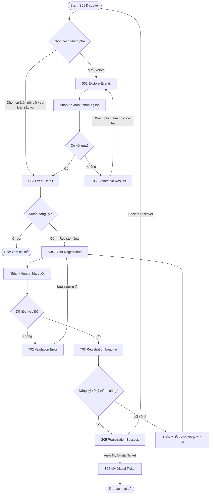
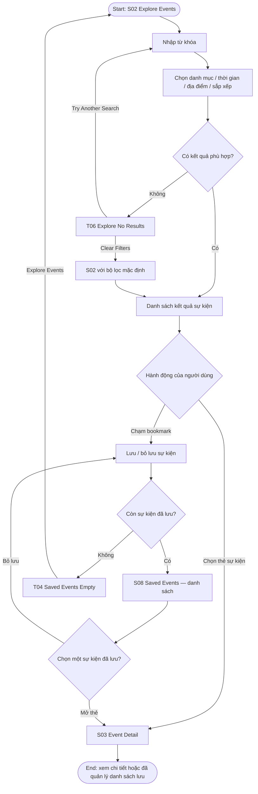
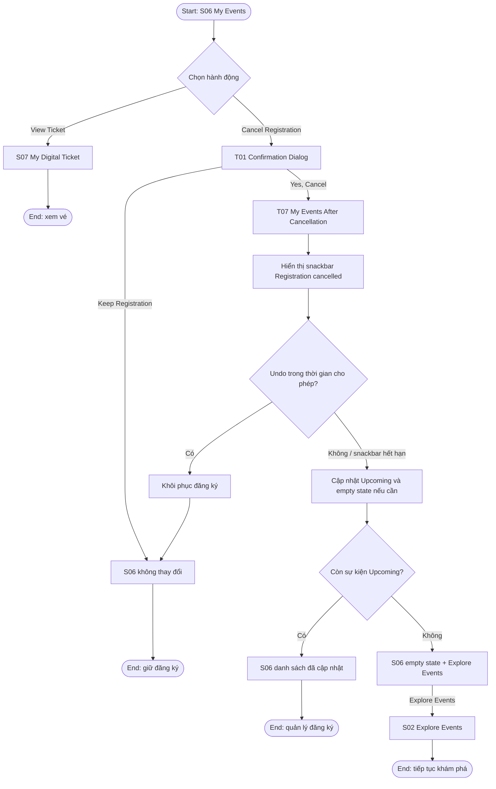
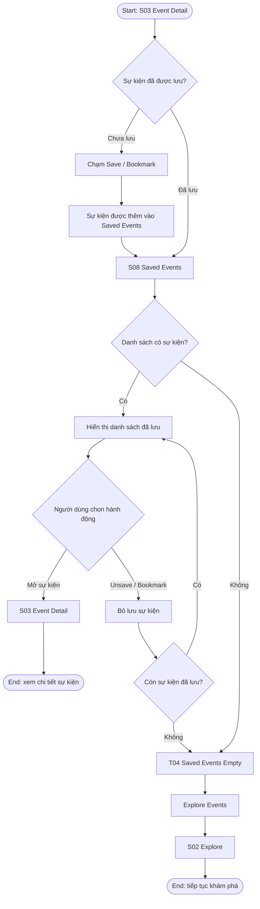

# Camply --- User Flow & Information Architecture

## 1. Mục tiêu UX

Giúp sinh viên: - Khám phá sự kiện sắp diễn ra và xem thông tin chi
tiết. - Tìm kiếm/lọc sự kiện theo từ khóa, danh mục, thời gian và địa
điểm. - Đăng ký sự kiện với biểu mẫu có kiểm tra dữ liệu, phản hồi khi
xử lý và xác nhận thành công. - Mở vé số, quản lý đăng ký, hủy đăng ký
có xác nhận và khôi phục thao tác nếu hủy nhầm. - Lưu sự kiện, xem thông
báo và quản lý hồ sơ.

## 2. Information Architecture (IA)

### 2.1 Cấu trúc điều hướng

```text
Camply
├── S01 Discover (tab chính)
│   ├── S03 Event Detail
│   │   └── S04 Event Registration
│   │       ├── T02 Validation Error (trạng thái hỗ trợ)
│   │       ├── T03 Registration Loading (trạng thái hỗ trợ)
│   │       └── S05 Registration Success
│   │           └── S07 My Digital Ticket
│   └── S09 Notifications
├── S02 Explore (tab chính)
│   ├── S03 Event Detail
│   ├── S08 Saved Events
│   │   └── T04 Saved Events Empty (trạng thái hỗ trợ)
│   └── T06 Explore No Results (trạng thái hỗ trợ của S02)
├── S06 My Events (tab chính)
│   ├── S07 My Digital Ticket
│   ├── T01 Cancel Registration Confirmation (dialog)
│   └── T07 My Events After Cancellation + Undo (trạng thái hỗ trợ)
└── S10 Profile (tab chính)
    ├── Edit Profile (đích prototype hỗ trợ)
    ├── App Settings (đích prototype hỗ trợ)
    └── Help & Support (đích prototype hỗ trợ)
```

### 2.2 Danh sách màn hình chính

---

ID Màn hình Vai trò / nội Điểm vào phổ biến
dung chính

---

S01 Discover / Home Sự kiện nổi bật, Mở app, tab
danh mục và sự Discover
kiện sắp tới

S02 Explore Events Tìm kiếm, lọc và Tab Explore, "See
xem danh sách sự all", "Explore
kiện Events"

S03 Event Detail Thông tin sự Chọn một sự kiện
kiện; tab About / từ S01/S02/Saved
Schedule /  
 Location; nút  
 Register Now

S04 Event Biểu mẫu đăng ký Register Now ở
Registration một trang S03

S05 Registration Xác nhận đăng ký; Gửi đăng ký hợp
Success View My Digital lệ
Ticket, Back to  
 Discover

S06 My Events Danh sách đăng ký Tab My Events
Upcoming/Past;  
 View Ticket,  
 Cancel  
 Registration

S07 My Digital Ticket Vé số, QR mô S05 hoặc S06
phỏng và thông  
 tin người tham  
 dự/sự kiện

S08 Saved Events Danh sách sự kiện Từ điều
đã lưu; bỏ lưu hướng/điểm vào
từng mục Saved Events được
thiết kế

S09 Notifications Thông báo theo Biểu tượng chuông
Today / This  
 Week, trạng thái  
 đã đọc/chưa đọc

S10 Profile Thông tin sinh Tab Profile
viên, hoạt động,  
 Settings &  
 Support

---

### 2.3 Trạng thái hỗ trợ (không tính là màn hình chính riêng)

---

ID Trạng thái Màn hình gốc Mục đích

---

T01 Cancel S06 Xác nhận trước
Registration hành động hủy
Confirmation

T02 Registration S04 Hiển thị lỗi tại
Validation Error các trường sai và
giữ dữ liệu đã
nhập

T03 Registration S04 Cho biết đang xử
Loading lý và ngăn gửi
trùng

T04 Saved Events S08 Hướng dẫn khi
Empty không còn sự kiện
đã lưu

T05 Notifications S09 Thông báo khi hộp
Empty thông báo trống

T06 Explore No S02 Giữ từ khóa/bộ
Results lọc và cung cấp
cách phục hồi

T07 My Events After S06 Hiển thị kết quả
Cancellation + hủy và cho phép
Undo Undo trong thời
gian ngắn

---

## 3. User Flow 1 --- Khám phá và đăng ký sự kiện

**Điểm bắt đầu:** S01 Discover\
**Mục tiêu:** Đăng ký thành công một sự kiện và mở được vé số.\
**Kết thúc thành công:** S07 My Digital Ticket.\
**Nhánh thay thế/lỗi:** Người dùng đi từ S02; biểu mẫu không hợp lệ dẫn
đến T02; gửi hợp lệ qua T03; có thể quay lại S03 trước khi gửi.



**Quy tắc tương tác** - Chỉ chuyển đến S05 khi các trường bắt buộc hợp
lệ và thao tác đăng ký hoàn tất. - Nếu sai dữ liệu, hiển thị T02, nêu
lỗi sát trường tương ứng và giữ lại giá trị người dùng đã nhập để sửa. -
Khi đang ở T03, vô hiệu hóa gửi lặp trong lúc xử lý. - S03 có nút Back
quay về màn hình nguồn trước đó (S01 hoặc S02). - Không thêm thanh toán
vào flow đăng ký.

## 4. User Flow 2 --- Tìm kiếm, lọc và lưu sự kiện

**Điểm bắt đầu:** S02 Explore Events\
**Mục tiêu:** Tìm một sự kiện phù hợp và lưu lại để xem sau.\
**Kết thúc thành công:** S08 Saved Events có sự kiện vừa lưu.\
**Nhánh thay thế:** Không có kết quả thì dùng T06 để xóa bộ lọc hoặc thử
từ khóa khác; bỏ lưu hết sự kiện sẽ dẫn đến T04.



**Quy tắc tương tác** - Bộ lọc đang chọn và từ khóa phải được giữ khi
hiển thị T06. - "Clear Filters" xóa bộ lọc hiện tại; "Try Another
Search" cho phép sửa từ khóa. - Chạm vào phần thẻ mở S03; chạm bookmark
chỉ lưu/bỏ lưu, không tự mở chi tiết. - Khi không còn sự kiện đã lưu,
hiển thị T04 với nút "Explore Events" dẫn về S02. - S08 dùng cấu trúc
thẻ ngang gọn, nhất quán với S02.

## 5. User Flow 3 --- Quản lý đăng ký, xem vé và hủy có thể khôi phục

**Điểm bắt đầu:** S06 My Events\
**Mục tiêu:** Xem vé hoặc hủy một đăng ký không còn cần thiết.\
**Kết thúc:** S07 khi xem vé; hoặc S06 đã cập nhật sau khi hủy; nếu hủy
nhầm, Undo khôi phục đăng ký.\
**Nhánh lỗi/phục hồi:** Người dùng có thể giữ đăng ký tại T01 hoặc hoàn
tác tại T07.



**Quy tắc tương tác** - Hủy đăng ký luôn mở T01 trước; không xóa sự kiện
ngay khi người dùng chạm Cancel Registration. - "Keep Registration" đóng
dialog và giữ nguyên S06. - "Yes, Cancel" cập nhật danh sách và hiển thị
T07 với snackbar "Registration cancelled." cùng Undo. - Undo chỉ khả
dụng trong khoảng thời gian ngắn khi snackbar còn hiển thị; sau khi hết
hạn, đăng ký không tự khôi phục. - Nếu Upcoming không còn sự kiện, S06
hiển thị "No Upcoming Events" và nút "Explore Events". - Vé mở từ S06
qua "View Ticket". Không thêm trạng thái "verified" hoặc "offline" nếu
chưa có hỗ trợ sản phẩm.

## 5. User Flow 4 — Save Favorites (F04)

**Luồng chính:** Detail → Save → Saved Events → Unsave  
**Điểm bắt đầu:** S03 Event Detail.  
**Mục tiêu:** Lưu sự kiện quan tâm để xem lại, sau đó có thể bỏ lưu.  
**Kết thúc thành công:** S08 Saved Events được cập nhật sau thao tác lưu hoặc bỏ lưu.  
**Nhánh bổ sung:** Khi danh sách đã lưu trống, T04 Saved Events Empty → Explore → S02.



**Quy tắc tương tác**

- Bookmark trên S03 lưu sự kiện; nếu sự kiện đã được lưu, thao tác bookmark bỏ lưu sự kiện đó.
- S08 hiển thị các sự kiện đã lưu bằng thẻ nhất quán với S02.
- Chạm vào thẻ mở S03; thao tác Unsave chỉ bỏ lưu, không tự mở chi tiết.
- Khi bỏ lưu sự kiện cuối cùng, chuyển sang T04.
- T04 có nút “Explore Events” dẫn đến S02 Explore.
- Không tạo thêm chức năng ngoài phạm vi Save, Saved Events, Unsave và nhánh danh sách trống.

## 6. Bảng ánh xạ User Flow ↔ màn hình

---

Flow Màn hình / trạng thái Mục tiêu
sử dụng

---

Flow 1 --- Discover & S01, S02, S03, S04, Khám phá, xem chi tiết,
Register T02, T03, S05, S07, T06 đăng ký, xử lý lỗi và
mở vé

Flow 2 --- Search & S02, T06, S03, S08, T04 Tìm/lọc, lưu hoặc bỏ
Save lưu sự kiện và phục hồi
khi không có kết quả

Flow 3 --- Manage & S06, S07, T01, T07, S02 Xem vé, xác nhận hủy và
Cancel hoàn tác thao tác

---

## 7. Điểm cần kiểm tra trong Figma Prototype

- Mỗi flow có starting point riêng và bấm được từ đầu đến cuối, không
  có nút dẫn đến ngõ cụt.
- Flow 1: S01/S02 → S03 → S04; nhánh sai dữ liệu T02 → S04; nhánh hợp
  lệ T03 → S05 → S07.
- Flow 2: S02 → kết quả hoặc T06; thao tác bookmark; S08 → S03; bỏ lưu
  hết → T04 → S02.
- Flow 3: S06 → S07; S06 → T01 → S06 (Keep); S06 → T01 → T07 (Cancel)
  → Undo khôi phục S06.
- Có ít nhất một dialog overlay (T01) và chuyển cảnh loading sang kết
  quả (T03 → S05).
- Kiểm tra 360 dp và 412 dp; chữ nội dung tối thiểu 14 sp; vùng chạm
  tối thiểu 48×48 dp; tương phản văn bản thường tối thiểu 4.5:1.
- Các đích Edit Profile, App Settings, Help & Support từ S10 cần được
  nối tới màn hình/đích prototype tương ứng nếu chúng xuất hiện như
  hành động có thể bấm.
- T05 Notifications Empty có thể được liên kết từ S09 khi không có
  thông báo; đây là trạng thái hỗ trợ, không phải flow chính riêng.

## 8. Ghi chú về phạm vi

- Tên, vai trò và cấu trúc S01--S10/T01--T07 được lấy từ tài liệu
  PREP-001.
- PRM323 Lab 2 yêu cầu tối thiểu 3 user flow hoàn chỉnh, mỗi flow có
  điểm bắt đầu, mục tiêu, điểm kết thúc, nhánh thành công và nhánh
  thay thế; ít nhất một flow có nhánh lỗi/phục hồi. Tài liệu này đáp
  ứng cấu trúc đó ở mức đặc tả.
- Những nhánh như lỗi xử lý đăng ký sau loading cần được thể hiện
  trong prototype bằng một trạng thái thông báo/lỗi rõ ràng nếu nhóm
  quyết định hỗ trợ; tài liệu hiện có xác định rõ T02 (lỗi validation)
  và T03 (loading), nhưng không mô tả đầy đủ một màn hình lỗi máy chủ
  riêng.
